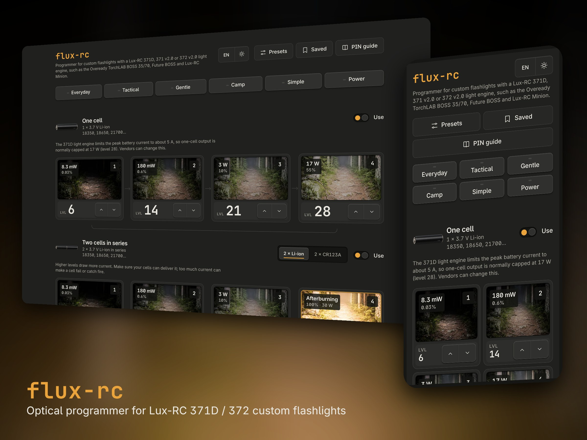
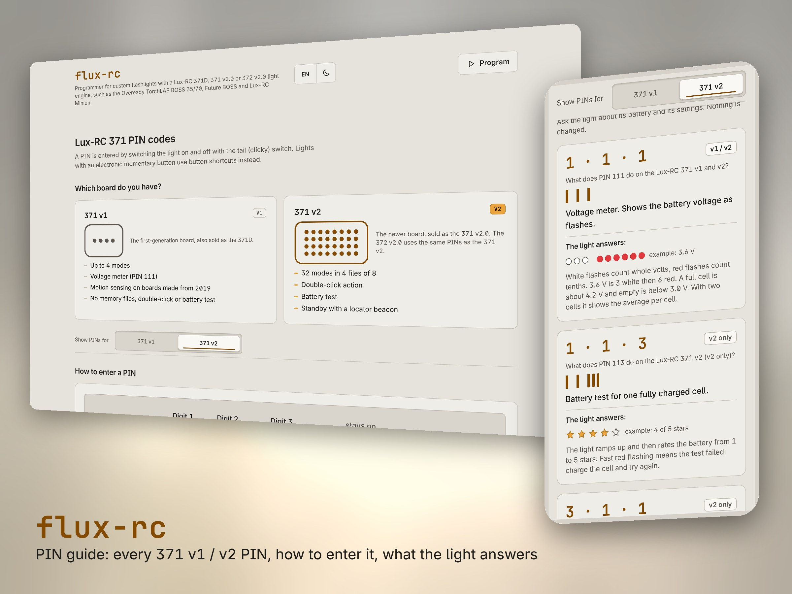
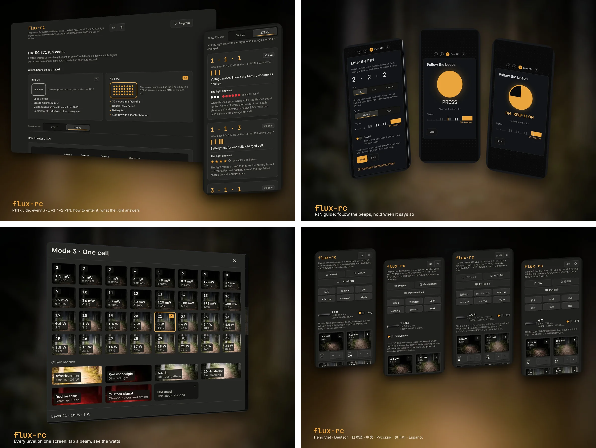

# flux-rc

> Made by a fan of [Lux-RC](https://lux-rc.com/). Not affiliated with, endorsed by or connected to Lux-RC or Oveready in any way.
> Non-commercial. Use at your own risk: no responsibility is taken for any device, battery or
> damage. Parts of the layout deliberately follow the original Lux-RC programmer so it feels familiar.

An optical programmer for custom flashlights with a Lux-RC 371D, 371 v2.0 or 372 v2.0 light engine,
such as the Oveready TorchLAB BOSS 35/70, Future BOSS and Lux-RC Minion. It sends the same signal as
Lux-RC's NXS R1 web programmer. Pick your modes and options, put the light into
programming mode, hold it against the screen, and the flashing square programs it.

**Use it here: https://flux-rc.stevensdesk.com/**

It is one static web page: no account, no server code, no analytics, nothing leaves your browser.
What changed and when: [CHANGELOG.md](CHANGELOG.md).







## What it does

- **Modes**: four modes for one 3.7 V Li-ion cell and four for two cells in series (or 2 × CR123A),
  picked from a grid that shows every level with its brightness and power.
- **Quick presets** (Everyday, Tactical, Gentle, Camp, Simple, Power) and the vendor presets from the original page.
- **Behaviour and advanced settings**: memory, Li-ion protection, battery stretch, bounce sensor,
  and the vendor safety settings (thermal limit, output limits, PIN, switch timeout), which default
  to "keep what the light has".
- **Step-by-step programming**: choose the switch (McClicky, or a MOFF e-switch that works inverted),
  get ready, then follow a beeping PIN rhythm guide (222, 112 or a vendor PIN) with a timeline of
  the clicks. After the final cue it counts down 2 s and starts the flashing square at the start
  of its loop, inside the few seconds the light waits in programming mode. Lights with a
  button-port e-switch can use the tailcap method instead.
- **Saved setups and share links**, stored in the browser.
- **PIN guide**: a separate page (`/guide/`) explaining how the PIN works, how to enter it with each switch type,
  and what to do when the light does not respond, linked from the topbar and the PIN step.
- **Nine languages**: English, Vietnamese, German, Japanese, Simplified and Traditional Chinese, Russian, Korean
  and Spanish, each on its own URL, picked from the browser or the topbar button.
- **Dark and light themes**: follows the browser at first, and one button flips to the other.

## Run it locally

```bash
npm run serve
```

Then open http://localhost:8080. Any static file server works; the page only needs to be served
over HTTP (not opened as `file://`) because it uses ES modules.

## Test

```bash
npm test
```

Uses the built-in Node test runner (Node 20 or newer). No dependencies to install.

## Deploy

Every push to `main` is built and published by Cloudflare (Workers static assets, project
`flux-rc-stevensdesk-com`) in under a minute. There is no build step: `wrangler.jsonc` publishes
the repo root, `.assetsignore` leaves out tests and tooling, and `_headers` sets caching (HTML
revalidates, code caches for 10 minutes, images and fonts for a week). The old GitHub Pages address
(joiha-steven.github.io/flux-rc) still serves the repo and redirects to the new domain.

Every other branch gets a preview build (`npx wrangler preview`, which needs the empty `previews` block in
`wrangler.jsonc`); the Cloudflare bot posts its URL on the pull request.

## Project layout

| Path | What it is |
|------|------------|
| `index.html` | The page (English, at `/`) |
| `vi/`, `de/`, `ja/`, `zh/`, `zh-hant/`, `ru/`, `ko/`, `es/` | The same page in each language, generated by `npm run pages` (do not edit by hand) |
| `guide/`, `vi/guide/`, `de/guide/` ... | The PIN guide (`guide/index.html` is English and the template), the other languages generated by `npm run guide` from `locales/guide/` (do not edit by hand) |
| `scripts/` | `build-pages.mjs` and `build-guide.mjs`, the page generators (not deployed) |
| `styles/` | CSS |
| `src/core/` | Protocol: config to fields, fields to frames, frames to GIF, validation. No DOM. |
| `src/data/` | Built-in presets |
| `src/ui/` | Page logic: rendering, state, storage, the program steps and PIN rhythm guide |
| `locales/` | Every user-visible string; `en.js` is the source, see `locales/README.md` |
| `test/` | Node tests; `test/fixtures/` holds GIFs recorded from the original programmer |
| `docs/protocol.md` | The optical protocol, reverse engineered and verified |
| `docs/config-model.md` | The config object the UI edits |
| `docs/design.md` | UI layout and behaviour |
| `docs/screenshots/` | Images for this README (not deployed); `overview.webp` is a 2 × 2 grid of `6-light`, `2-pin`, `3-picker` and `4-languages` |
| `CHANGELOG.md` | What changed on the live page, by date |
| `wrangler.jsonc`, `.assetsignore`, `_headers` | Cloudflare deploy settings |
| `robots.txt`, `sitemap.xml`, `assets/og.jpg` | For search engines and link previews |

## How it works

The driver reads the length of white pulses: 40 ms means 0, 140 ms means 1, 240 ms means "leave
this setting unchanged". A packet carries a header, 15 settings and a checksum, and loops forever.
flux-rc builds the same animated GIF as the original programmer, byte for byte. Details in
[docs/protocol.md](docs/protocol.md).

## Status

- The encoder matches all ten GIFs recorded from the original, byte for byte.
- It has programmed a real flashlight, and the PIN rhythm guide has been used on a real light.
- The advanced settings (thermal limit, output limits, PIN, switch timeout) are derived from vendor
  presets and have not been tested on a light yet.
